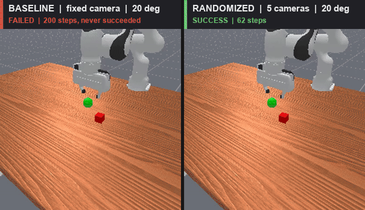
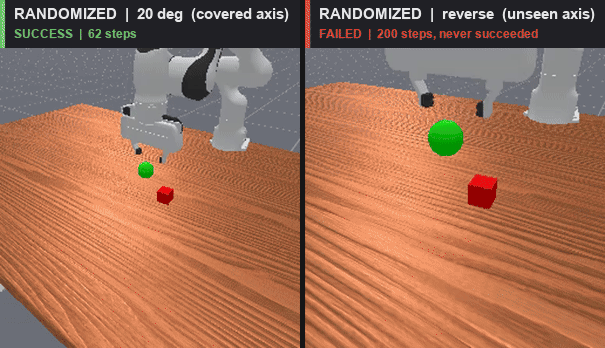

# ManiSkill π0.5 视觉泛化实验

在 ManiSkill 的 PickCube 任务上，用 π0.5（LoRA 微调）测量 VLA 策略的**视觉泛化边界**，
并验证「相机随机化」这一数据增广手段的有效范围。

---

## 一句话结论

> **相机随机化把训练轴上的断崖彻底填平（20° 从 0% → 84%），
> 但三条正交方向（反向 / 侧向 / 垂直）完全没有改善（0% / 2% / 14%，与基线一致）。**
> （分布内 51% → 98% 这一项混有 FOV 偏差，见底部局限 #4）
>
> → 它是有效的**数据增广**，不是泛化能力的来源。



<p align="center"><sub>同种子 1000、同相机 20°，左右同时播放：<b>左</b>基线跑满 200 步始终没完成　|　<b>右</b>随机化模型 62 步完成。右边 3.45 s 就结束了（画面压暗标注），左边还在继续尝试。</sub></p>

---

## 结果速览

| 指标 | 基线（固定相机） | 随机化（5 档相机） |
|---|---|---|
| **ind**（分布内） | 51/100（51%） | **98/100（98%）** |
| **ood_color**（未见颜色） | 61/100（61%） | 87/100（87%） |
| **ood_cam**（相机 20°） | 1/100（1%） | **86/100（86%）** |
| 视角 0° | 22/50（44%） | 45/50（90%） |
| 视角 5° | 48/50（96%） | 41/50（82%） |
| 视角 10° | 9/50（18%） | 46/50（92%） |
| 视角 14° | 3/50（6%） | 37/50（74%） |
| 视角 20° | 0/50（0%） | 42/50（84%） |
| 视角 25°（超出训练范围） | 0/50（0%） | 17/50（34%） |
| **反向相机**（未见方向） | 0/50（0%） | **0/50（0%）** |
| **侧向相机**（未见轴） | 1/50（2%） | **1/50（2%）** |
| **垂直相机**（未见轴） | 7/50（14%） | **7/50（14%）** |

> `ind` 一行（51% vs 98%）混有 FOV 与初始化差异（见底部局限 #4 / #6），只能读方向；
> 20° 那一行与三条正交轴这两组对照，两个模型条件相同，结论不受影响。

逐集原始数据在 [`results/`](results/)，每格都是实测，24 格与主表逐格核对过。

### 四个关键发现

1. **训练轴上断崖被填平。** 25° 虽超出训练覆盖的 0–20°，仍从 0% 提到 34%，
   说明模型形成了**连续的**视角表征，而不是记住 5 个离散位置。
2. **训练轴以外完全无效。** 三个正交方向一个都没改善，这是本实验最重要的负面结论。
3. **分布内性能翻倍（意外收获）。** 51% → 98%，多视角数据等效于 5 倍增广。
   ⚠️ 这一格混有 FOV 与初始化差异，只能读方向（局限 #4 / #6）。
4. **颜色不是瓶颈。** 两个模型在 OOD 颜色上都表现良好。



<p align="center"><sub>同一套随机化权重：<b>左</b> 20°（训练覆盖）62 步成功　|　<b>右</b> 反向（训练从未覆盖）跑满 200 步失败。</sub></p>

| 主张 | 证据 | 判断 |
|---|---|---|
| 相机随机化有效 | 训练轴 20° 从 0%→84% | ✅ 成立 |
| 随机化学到了「真泛化」 | 三个正交方向 0/2/14%，与基线完全相同 | ❌ **不成立** |
| 随机化提升整体性能 | IND 51%→98% | ⚠️ 方向成立，但混有 FOV 与初始化差异 |
| 视角是 VLA 的瓶颈 | 基线 14° 就崩到 6% | ✅ 成立 |

**解读**：随机化买到的是「这条轴上的插值能力」，不是「视角不变性」。
真正的视角泛化需要多轴同时随机化，甚至需要架构层面的改动（3D 表征 / 视角等变网络）。

---

## 这个仓库做了什么

- 一套把「只有 state+action 的官方演示」回放成视觉数据集的方法（**228 帧/秒**，1000 条 5 分钟）
- 一套保证单变量的 OOD 数据构造方式：改颜色 / 改相机位姿，**物理不变、动作标签仍有效**
- π0.5 + LoRA 在 ManiSkill 上的完整训练配置（含 `output_action_dim` 修复与 `freeze_filter`）
- 12 格泛化评测矩阵，含**三条训练从未覆盖的正交相机轴**作为真泛化判据
- 双进程评测架构（openpi venv 跑服务 + ManiSkill venv 跑环境，WebSocket 通信）
- 8 段评测录像，含同种子、同相机的 A/B 对照
- 12 个实际踩过的工程坑（现象 → 原因 → 解法），见 [`docs/02`](docs/02_pitfalls_and_failures.md)

### 这不是什么

不是从零实现的框架，也不是 benchmark 榜单提交。ManiSkill 与 openpi 都是上游依赖，
本仓库贡献的是**数据构造脚本 + 上游补丁 + 评测协议 + 实验结论 + 完整偏差披露**。
哪些是上游原有能力、哪些是本项目新增，见 [`CUSTOM_CHANGES.md`](CUSTOM_CHANGES.md)。

---

## 快速开始

需要两个**无法合并**的 Python 环境（原因见 [`docs/02` 坑 7](docs/02_pitfalls_and_failures.md)）：

| 环境 | Python | 用途 |
|---|---|---|
| A. openpi（JAX） | 3.11 | 训练、策略服务 |
| B. ManiSkill（SAPIEN） | 3.10 | 数据生成、评测客户端 |

环境 B 的依赖见 [`requirements.txt`](requirements.txt)；环境 A 直接用 openpi 自己的 `uv sync`。

```bash
# ── 只需要设置这几个环境变量，脚本内部全部走它们，没有硬编码路径 ──
export OPENPI_ROOT=/path/to/openpi        # openpi 仓库根目录
export LEROBOT_HOME=/path/to/lerobot      # LeRobot 数据集根目录
export PY=$CONDA_PREFIX/bin/python        # 环境 B 的解释器（含 mani_skill）
export MS_ASSET_DIR=/path/to/ms_assets    # ManiSkill 仿真资产（8.2 GB），可选
export CKPT_ROOT=/path/to/checkpoints     # 断点输出目录，默认 <仓库>/checkpoints
export VK_ICD_FILENAMES=/etc/vulkan/icd.d/nvidia_icd.json   # 无显示环境时通常必须

bash scripts_local/00_check_env.sh        # 8 项自检
bash scripts_local/01_download_demos.sh   # 下载官方演示（只有 state+action）

# ── 造数据 ──
bash   scripts_local/02b_gen_all_splits.sh 600          # IND / OOD-颜色 / OOD-相机
$PY    scripts_local/03_build_dataset_randcam.py --n 1000   # 5 档随机相机
$PY    scripts_local/04_convert_to_lerobot.py \
         --src dataset/ind --root $LEROBOT_HOME --repo-id pickcube_ind
bash   scripts_local/05_compute_norm_stats.sh

# ── 训练（单卡 L40 ≈ 5.7 小时 / 次）──
bash scripts_local/06_train_baseline.sh   # 基线：固定相机
bash scripts_local/07_train_randcam.sh    # 随机化：5 档相机

# ── 评测（两个终端）──
bash scripts_local/07b_serve_policy.sh pi05_pickcube_lora <断点目录>/11999
bash scripts_local/09_eval_full_protocol.sh baseline results/baseline
```

完整 12 步走法与 8 项检查清单见 [`docs/03_runbook.md`](docs/03_runbook.md)。

---

## 目录

```text
scripts_local/                  可运行脚本（按序号执行）+ common.sh（统一环境变量）
  common.sh                     所有脚本共用；$OPENPI_ROOT / $PY 等在此集中
  00_check_env.sh               环境自检（8 项）
  01_download_demos.sh          下载官方演示
  01b_replay_render_speedtest.py 回放渲染测速（228 帧/秒验证）
  02_build_dataset.py           生成 IND / OOD-颜色 / OOD-相机 三套数据
  02b_gen_all_splits.sh         批量生成三套
  03_build_dataset_randcam.py   生成 5 档随机相机数据
  04_convert_to_lerobot.py      npz → LeRobot v2.1
  05_compute_norm_stats.sh      归一化统计量
  06_train_baseline.sh          训练基线
  07_train_randcam.sh           训练随机化
  07b_serve_policy.sh           启动策略服务（WebSocket :8000）
  08_eval_single_split.py       单格评测（客户端，不加载权重）
  09_eval_full_protocol.sh      完整 12 格协议 ← 产出主表的就是它
  10_watch_and_eval.sh          看门狗：等断点 → 自动起服务 → 自动评测
  11_record_videos.py           录制评测视频（必须 256×256）
  12_make_comparison_gifs.py    把录像拼成并排 A/B 对照 GIF

scripts_local/_archive/         7 个历史脚本，原样保留供回溯，直接跑会失败
                                详见 _archive/README.md

openpi_patch/pickcube_lora_config.patch      对 openpi config.py 的 3 处改动
maniskill_patch/pick_cube_color.patch        对 ManiSkill pick_cube.py 的 2 处改动

docs/
  01_experiment_design_and_results.md   实验设计与结果
  02_pitfalls_and_failures.md           12 个实际踩过的坑
  03_runbook.md                         从零复现的 12 步
  04_deviations_and_limitations.md      偏差与局限 ← 建议先读

results/
  README.md                     字段与文件名含义
  results_table.md              结果总表
  baseline/*.json               基线 12 格逐集数据
  randcam/*.json                随机化 12 格逐集数据

media/
  comparison_*.gif              2 段 A/B 对照动画（README 内嵌的就是它们）
  COMPARISON.png                首末帧对比图
  *.mp4                         8 段评测录像（清单见 media/README.md）
```

---

## 评测协议

每格都是「同种子、同协议、配对比较」（种子固定为 `1000 + episode`，两个模型完全一致）：

| 组别 | 格子 | 集数 |
|---|---|---|
| 主实验 | `ind` / `ood_color` / `ood_cam` | 100 |
| 训练轴正向扫描 | 0° / 5° / 10° / 14° / 20° / 25° | 50 |
| **正交轴**（真泛化判据） | 反向 / 侧向 / 垂直 | 50 |

单集上限 200 步（演示平均 74 步），每次推理执行前 10 步（`action_horizon=50`）。
每个模型 750 集，合计 1500 集。

---

## 局限（建议先读这里）

这是一个**单任务的探索性实验**，以下偏差无法消除，请按此强度引用结论：

| # | 局限 | 影响 |
|---|---|---|
| 1 | **单随机种子**（每多一个种子需再训 5.7 小时） | 无法区分「随机化有效」与「这个种子运气好」 |
| 2 | 扫描格 **n=50**（二项标准误 ≈ ±7%） | 细粒度数字别当精确测量；基线 0°=44% 而 5°=96% 的非单调很可能是噪声 |
| 3 | **训练数据量不等**：基线 1200 条 / 随机化 1000 条 | 随机化少 16%，可能略低估其效果 |
| 4 | **FOV 不完全一致**：基线数据 `fov=1.1`，随机化与评测 `fov=1.05` | ⚠️ 混入的第二个视觉变量，`ind` 的 51%→98% 含此偏差，见 [`docs/04`](docs/04_deviations_and_limitations.md) |
| 5 | 随机化只沿**一条轴**（等效 0–20°），不是三轴 | 正交轴零迁移正是这条设计的直接后果 |
| 6 | **基线训练时 base 权重有 3 个块被截断**，随机化模型用的是修复后的权重——两者初始化不完全一致 | 与 #4 一起构成「相机位姿」之外的混杂变量，可能高估随机化的提升 |
| 7 | 动作执行方式（RHC）「每 10 步推理」未做消融 | 两模型用同一值，公平但未验证敏感性 |

### 读者不应从这个实验得出的结论

- ❌ 「相机随机化能提升 VLA 的泛化能力」——它只在覆盖的子空间内有效
- ❌ 「π0.5 的视觉泛化边界是 14°」——这是**单一任务、单一种子、256×256** 下的结果
- ❌ 「正交轴零改善说明模型完全没学到视角不变性」——只能说在这个任务和这个增广下没体现出来

### 一个未被纳入正式结论的发现

改用 512×512 录制视频时（评测协议是 256×256），基线模型在 0° 下 5/5 全败，改回 256 后恢复正常。
**该策略对渲染分辨率同样敏感**——这是比相机扰动更隐蔽的一种分布偏移。

---

## 应用补丁

```bash
# 1. openpi 配置补丁
cd /path/to/openpi
git apply --check /path/to/maniskill-pickcube-vg/openpi_patch/pickcube_lora_config.patch
git apply         /path/to/maniskill-pickcube-vg/openpi_patch/pickcube_lora_config.patch
# ⚠️ patch 里的 weight_loader 路径是占位符 /path/to/pi05_base/params，需改成自己的

# 2. ManiSkill 颜色补丁
cd /path/to/site-packages/mani_skill     # 或在 site-packages 下用 patch -p1
patch -p1 --dry-run < /path/to/maniskill-pickcube-vg/maniskill_patch/pick_cube_color.patch
patch -p1           < /path/to/maniskill-pickcube-vg/maniskill_patch/pick_cube_color.patch
```

补丁基于：openpi（JAX 0.5.3 / Flax 0.10.2）、ManiSkill **3.0.1**、SAPIEN **3.0.3**。

---

## 硬件与规模

| 项 | 值 |
|---|---|
| GPU | 单卡 NVIDIA L40（46 GB） |
| 训练 | 12,000 步 / batch 8 / 1.7 秒每步 / 5.7 小时 |
| 显存 | 34.7 GB |
| 可训练参数 | 50.0 M（LoRA rank 16/32，占 1.47%） |
| 评测 | 1500 集（两个模型 × 750 集） |
| 回放渲染 | 228 帧/秒 |

## 本仓库不包含

```text
模型权重（π0.5 base 12.44 GB、训练断点 13 GB/个）
LeRobot 数据集（4 套，约 25 GB）
ManiSkill 仿真资产（ms_assets 8.2 GB）
虚拟环境 / 训练日志 / 录像原始帧
```

获取方式见 [`docs/03_runbook.md`](docs/03_runbook.md) 第 1–3 步。

---

## 许可与致谢

本仓库以 [MIT](LICENSE) 授权。它修改（以补丁形式）了两个 Apache-2.0 上游项目：

- [openpi](https://github.com/Physical-Intelligence/openpi) — π0 / π0.5 的实现与训练框架
- [ManiSkill](https://github.com/haosulab/ManiSkill) — 仿真环境与官方演示

π0.5 模型权重、官方演示数据、仿真资产均不在此仓库内，其使用须遵守各自上游许可。
